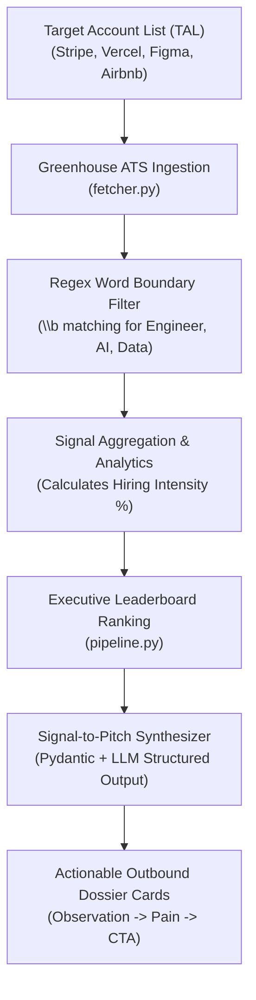

# ⚡ Hiring-to-Pipeline: Automated B2B Signal Intelligence & Pitch Engine

An automated Go-To-Market (GTM) data pipeline that monitors live job boards across enterprise Target Account Lists (TAL), detects technical hiring spikes, calculates hiring intensity metrics, and synthesizes 1-to-1 personalized sales pitches for engineering leaders.

---

## 🎯 The Business Problem

When a tech company posts dozens of engineering roles, they reveal two critical commercial facts:
1. **They have allocated budget.**
2. **They have an immediate, acute operational bottleneck.**

However, sales development reps (SDRs) and account executives face three massive hurdles:
* **Information Overload:** A single enterprise account like Stripe has nearly 800 open jobs. Finding the relevant technical signal manually takes hours.
* **Generic Outreach:** Sales reps default to spray-and-pray email blasts that get <1% reply rates.
* **False Positives:** Naive keyword matching confuses non-technical roles like *"Retail Specialist"* or *"Campaign Manager"* for technical AI/ML openings.

**Hiring-to-Pipeline** automates the entire ingestion, regex word boundary filtering, hiring intensity analytics, and signal-to-pitch synthesis in **under 3 seconds**.

---

## 🏗️ System Architecture



---

## ⚡ Key Engineering Highlights

### 1. High-Throughput Public ATS Ingestion (`fetcher.py`)
Rather than scraping brittle web pages, the engine directly interfaces with public Applicant Tracking System (ATS) APIs (Greenhouse), retrieving and parsing 1,200+ raw enterprise listings concurrently with connection pooling via `httpx.AsyncClient`.

### 2. Regex Word Boundary Defense (`\b`)
Eliminates the common "Short Keyword Substring Trap." Simple substring checks for keywords like `"ai"` mistakenly match non-technical roles like `"Ret[ai]l Manager"` or `"Camp[ai]gn Specialist"`. The engine applies regex word boundaries (`r'\b' + re.escape(kw) + r'\b'`) to ensure 100% precision.

### 3. Hiring Intensity & Velocity Analytics (`models.py`)
Raw job volume alone is misleading (e.g. 200 jobs at a 10,000-person enterprise vs 20 jobs at a 50-person startup). The engine computes a custom metric:
$$\text{Hiring Intensity} = \left(\frac{\text{Target Technical Roles}}{\text{Total Company Open Roles}}\right) \times 100$$
This instantly reveals which companies are aggressively tilting their headcount toward technology expansion (e.g., Vercel hiring at 32.6% intensity).

### 4. Signal-to-Pitch Synthesis (`pitch-prompt.txt`)
Instead of generating generic robotic emails, the engine enforces the high-converting **3-Sentence Sales Framework**:
* **Sentence 1 (Observation):** Cites the exact hiring volume and flagship role title.
* **Sentence 2 (Problem Bridge):** Connects rapid headcount expansion to the inevitable operational bottleneck (e.g., skyrocketing cloud model bills, environment setup lag).
* **Sentence 3 (Low-Friction Ask):** Offers benchmark specs or a 90-second demo instead of demanding a 30-minute calendar call.

---

## 🧪 Live Pipeline Output

### 1. Executive Hiring Leaderboard
```text
🏆 TARGET ACCOUNT HIRING LEADERBOARD:
• STRIPE: 221 technical roles (28.1% of total 786 jobs)
• AIRBNB: 51 technical roles (23.8% of total 214 jobs)
• FIGMA: 37 technical roles (26.6% of total 139 jobs)
• VERCEL: 28 technical roles (32.6% of total 86 jobs)
• SUPABASE: 0 technical roles (0.0% of total 0 jobs)
```

### 2. Synthesized Outbound Pitch Cards

#### Target: Vercel (Highest Hiring Intensity)
```json
{
  "company": "VERCEL",
  "target_persona": "VP of Infrastructure",
  "observation_hook": "Noticed Vercel currently has 28 open tech roles out of 86 total listings, putting technical hiring intensity at 32.6%.",
  "pain_point_bridge": "Scaling engineering headcount at that rate quickly compounds recurring cloud AI bills as dev teams rely heavily on hosted models for day-to-day code completion.",
  "call_to_action": "Open to a quick benchmark review showing how our local GPU Mini hardware pulls those models on-box to cut cloud inference spend?"
}
```

#### Target: Stripe (Highest Raw Volume)
```json
{
  "company": "STRIPE",
  "target_persona": "Head of Infrastructure",
  "observation_hook": "Noticed Stripe currently has 221 open tech roles across 786 total listings (a 28.1% tech hiring intensity), alongside an expansion in AI sales.",
  "pain_point_bridge": "Scaling that engineering headcount usually compounds cloud AI model spend as hundreds of developers hit hosted endpoints for day-to-day code generation.",
  "call_to_action": "Worth passing along the GPU Mini spec sheet to see if running those models on local hardware pencils out for your team?"
}
```

#### Target: Figma
```json
{
  "company": "FIGMA",
  "target_persona": "VP of Engineering",
  "observation_hook": "Saw Figma's hiring push with 37 tech openings out of 139 total roles (a 26.6% tech hiring intensity), including an AI Applied Scientist.",
  "pain_point_bridge": "Ramping up applied AI talent quickly inflates monthly cloud model bills when developers rely on remote APIs for code generation and local experimentation.",
  "call_to_action": "We just launched GPU Mini to let engineering teams run proprietary and open-source models locally off-cloud—worth sending over the spec sheet to see if it trims your inference overhead?"
}
```

---

## 🚀 Setup & Execution

### 1. Prerequisites
* Python 3.11+
* Antigravity CLI (`agy`) or configured LLM runner

### 2. Installation
```bash
cd hiring-pipeline

python3 -m venv venv
source venv/bin/activate
pip install -r requirements.txt
```

### 3. Run the Pipeline
```bash
python3 pipeline.py
```

---

## 🛠️ Tech Stack
* **Language:** Python 3.11+
* **Data Modeling:** Pydantic v2 (BaseModel, computed properties)
* **Async HTTP:** `httpx` with connection pooling
* **Pattern Matching:** Regex with word boundaries (`\b`)
* **AI Orchestration:** Structured prompt engineering with strict JSON output contracts
* **Data Sources:** Public Greenhouse ATS APIs


---

## 💼 Work With Me / Hiring

I am a Software Engineer specializing in **Go-To-Market (GTM) Engineering, Signal-Based Outbound, and Revenue Infrastructure**.

If your team is:
* Spending 20+ hours a week manually vetting leads, searching job boards, or monitoring hiring spikes.
* Struggling with generic, low-converting outbound email blasts that get ignored.
* Looking to build automated data pipelines that turn commercial buying signals into high-converting revenue pipeline.

**I am currently open to full-time roles, contract projects, and GTM advisory engagements.**

* 🔗 **LinkedIn:** [linkedin.com/in/sameer-ankalagi](https://www.linkedin.com/in/sameer-ankalagi)
* 📧 **Email:** [330.sameer@gmail.com](mailto:330.sameer@gmail.com)
* 💻 **GitHub:** [@Sameer330](https://github.com/Sameer330)
